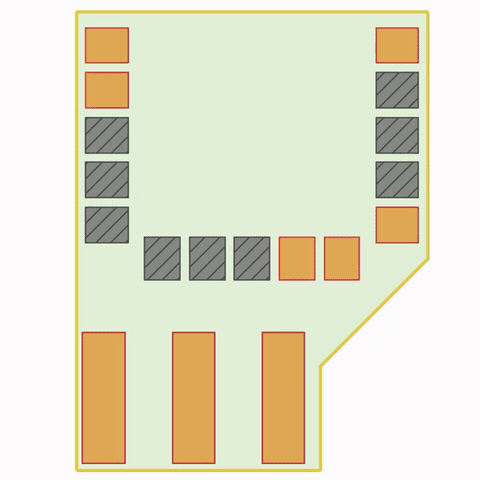
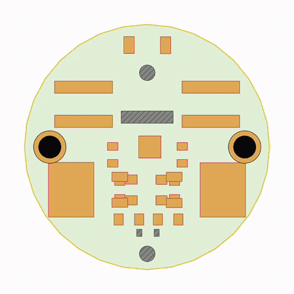

# PCBWorld

A reinforcement-learning environment for PCB routing, built on KiCad's interactive router.

| | |
|---|---|
| **Version** | <!--VERSION-->v1.1.1<!--/VERSION--> |
| **KiCad** | 9.0.8 (via the engine submodule) |
| **Python** | 3.12+ |
| **Platform** | Linux x86_64 (primary), macOS |
| **License** | [BSD-3-Clause](LICENSE); the engine is GPLv3 (see Licensing below) |

PCBWorld wraps KiCad's push-and-shove router as a [Gymnasium](https://gymnasium.farama.org/)
environment. An agent places tracks and vias on a real `.kicad_pcb` board, and every step is
scored by KiCad's own design-rule checker. What routes here routes in KiCad.

The repository ships the environment, synthetic board generators, the real-board benchmark
splits, one evaluation pipeline shared by every method, and three families of baselines:
a decoder-only PPO/GRPO transformer, LLM tool-calling agents, and the rule-based routers
FreeRouting and KRT.

## Demo

An LLM agent routing two production boards end to end (time-lapse; click for the full video):

| `0018_hy_adapter` | `0100_smt-zvs-driver` |
|---|---|
| [](PCBWorld_media/0018_Hardware_Playground_hy_adapter_episode_00_env_00_GPT_success.mp4) | [](PCBWorld_media/0100_smt-zvs-driver_IH10-mc_GPT_success.mp4) |

All supplementary videos: [PCBWorld_media/index.html](PCBWorld_media/index.html).

## Using the environment

```python
from configs.loader.schema import EnvConfig
from pcb_world.core.env import PCBWorld
from pcb_world.core.action_schema import ACT_NET_SELECT, ACT_START_ROUTE, ACT_MAKE_LINE, ACT_NET_END

# EnvConfig: every env setting (defaults: configs/env.yaml)
env = PCBWorld("tests/fixtures/simple_routing_board.kicad_pcb", EnvConfig.with_overrides(max_steps=200))
obs, info = env.reset(seed=0)

src, dst = obs["board_static"]["nets"]["net_1"]["pads"].values()
(x0, y0), (x1, y1) = src["center"]["xy"], dst["center"]["xy"]

for action in (
    {"action_type": ACT_NET_SELECT, "net_id": 1},
    {"action_type": ACT_START_ROUTE, "x_mm": x0, "y_mm": y0, "layer": src["layer"]},
    {"action_type": ACT_MAKE_LINE, "x_mm": x1, "y_mm": y1, "routing_mode": 2},
    {"action_type": ACT_NET_END},
):
    obs, reward, terminated, truncated, info = env.step(action)
```

State, actions and reward: [docs/ENVIRONMENT.md](docs/ENVIRONMENT.md).

## Quick start

### 1. Setup

```bash
git clone --recursive https://github.com/LGAI-Research/PCBWorld.git pcbworld && cd pcbworld
bash tools/setup/setup_all.sh        # conda env, pinned baselines, engine build, import smoke
conda activate pcbworld && export PYTHONPATH=build_rl/pcbnew/python/rl:. PCBWORLD_DATA_ROOT=$PWD/var/datasets
```

macOS first: `brew install cmake ninja wxwidgets libgit2 protobuf ngspice libngspice pkgconf nng unixodbc`.

### 2. Open-source boards (D3)

```bash
bash tools/quickstart/prepare_pcbench.sh --limit 30 --workers 8
```

Collects the [PCBench](https://github.com/PCBench/PCBench) boards and preprocesses them into the
D3 benchmark set. Drop `--limit` for all of them.

### 3. Train an RL policy

```bash
bash tools/quickstart/train_rl.sh --data-dir var/datasets/synthetic/synth_2L_v2 --boards 200 --iterations 5 --seed 42
```

Generates the boards when the directory is empty, trains PPO on them, and evaluates the policy
on the test split.

### 4. Route with an LLM

```bash
GEMINI_API_KEY=... bash tools/quickstart/run_llm.sh   # or OPENAI_API_KEY, ANTHROPIC_API_KEY, TOGETHER_API_KEY
```

Any one key works; the script picks the provider from it (Gemini has a free tier). Without a key
it only prints the prompt and runs a single fixed step.

The shipped defaults use a newer potential-function combination than the paper. To reproduce the
KDD submission with its original reward, follow [experiments/kdd/](experiments/kdd/README.md).

## Licensing

PCBWorld is two programs, distributed separately:

| Program | Where | License |
|---|---|---|
| **PCBWorld**: the environment, agents, benchmark, training and evaluation code | this repository | [BSD-3-Clause](LICENSE) |
| **PCBWorld Engine**: the KiCad modifications, the RL router, the engine server | [LGAI-Research/PCBWorld-Engine](https://github.com/LGAI-Research/PCBWorld-Engine), pinned here as the `engine/` submodule | GPLv3 |

Third-party notices: [Notice.md](Notice.md).

## Citation

Accepted to the KDD 2026 Workshop on Evaluation and Trustworthiness of Agentic AI
([arXiv:2607.05915](https://arxiv.org/abs/2607.05915), [PCBWorld.pdf](PCBWorld.pdf)).

```bibtex
@inproceedings{song2026pcbworld,
  title     = {PCBWorld: A Benchmark Environment for Engine-Grounded
               PCB Design Automation},
  author    = {Song, Hyungseok and Park, Junseok and Choi, Won-Seok and
               Bae, Seohui and Jeong, Han-Seul and Park, Youngjoon and
               Lee, Soonyoung},
  booktitle = {KDD 2026 Workshop on Evaluation and Trustworthiness of
               Agentic AI},
  year      = {2026},
  note      = {arXiv:2607.05915},
}
```

## Contact

Open an issue, or write to hyungseok.song@lgresearch.ai. Bug reports and pull requests are welcome.
